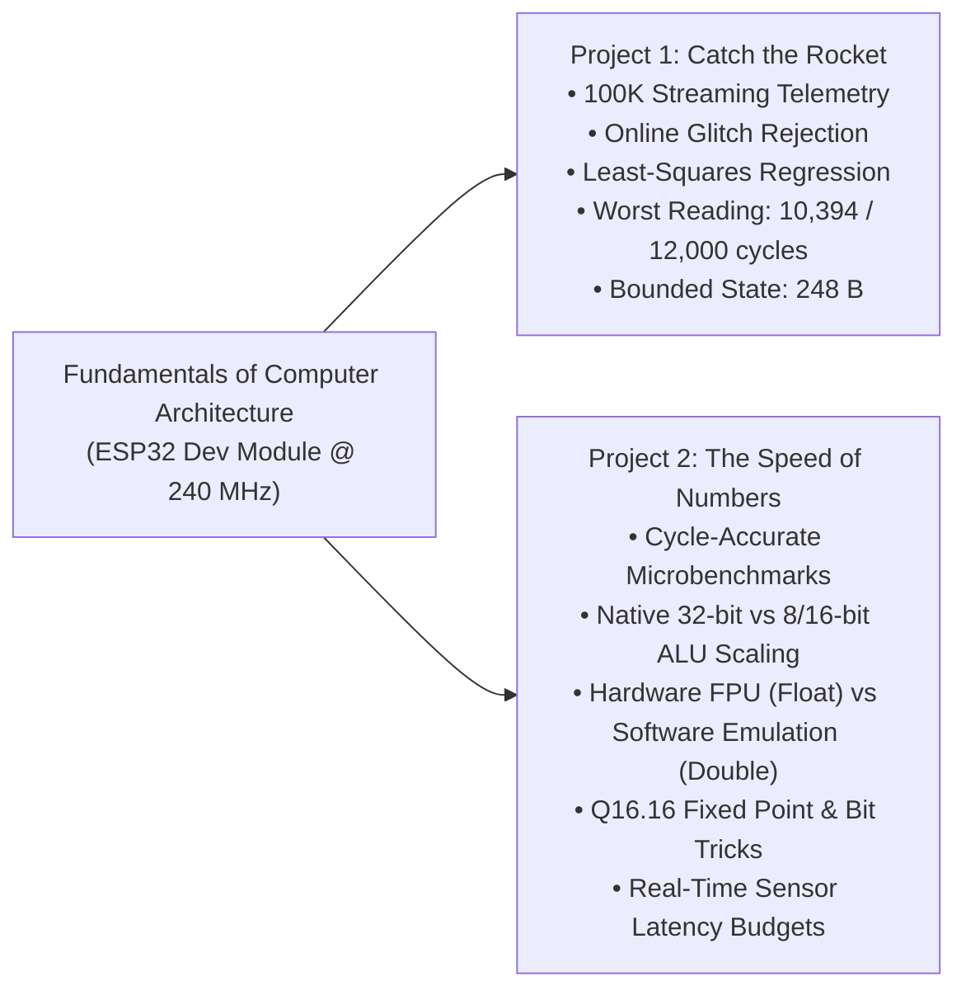

# Fundamentals of Computer Architecture (FCA)

[](https://www.espressif.com/)
[](https://www.arduino.cc/en/software)
[]()
[]()

> **Individual Academic Portfolio**  
> **Course:** Fundamentals of Computer Architecture (FCA)  
> **Author:** Harshitha Paramesh  
> **Target Hardware:** ESP32 Dev Module (Xtensa Dual-Core 32-bit LX6 Microprocessor @ 240 MHz)  

---

## Repository Overview

This repository contains the complete implementation, microarchitectural benchmarks, experimental evidence, and technical documentation for the **Fundamentals of Computer Architecture (FCA)** coursework.

The repository is structured into two major projects:



1. 🚀 **[Catch the Rocket](#1-project-1--catch-the-rocket-streaming-telemetry--flight-estimation):** Real-time streaming ground-station estimation system processing 100,000 altitude telemetry readings in single-pass mode under strict memory ($\le 4\text{ KB}$) and latency ($\le 12,000\text{ cycles}$) constraints.
2. ⏱️ **[The Speed of Numbers](#2-project-2--the-speed-of-numbers-microarchitectural-benchmarking):** Microarchitectural cycle-level benchmarking investigating the latency and throughput of data types, hardware FPU vs software emulation, bitwise optimizations, fixed-point math, and UART serialization bottlenecks.

---

## 1. Project 1 — Catch the Rocket (Streaming Telemetry & Flight Estimation)

### Overview
A sounding rocket flight telemetry stream (100,000 readings @ 1 kHz) is analyzed online on the ESP32. Due to strict embedded memory constraints, readings cannot be buffered in RAM. Instead, running mathematical accumulators process each incoming datum in real time.

- **Streaming Telemetry:** 100,000 total readings, 99,998 valid, 2 sensor glitches.
- **Working State Memory:** **248 bytes** (Constraint: $\le 4,096\text{ bytes}$, 94% headroom).
- **Processing Latency:** **10,394 cycles / reading** worst-case (Budget: $\le 12,000\text{ cycles}$, 1,606 cycle margin).
- **Online Glitch Filter:** Extrapolative linear predictor ($\hat{h}_k = 2h_{k-1} - h_{k-2}$, threshold $20.0\text{ m}$) isolates glitches prior to accumulator updates.
- **Trajectory Estimation:** Quadratic regression during coast phase ($t \le 8\text{ s}$) yields effective gravity ($g = -2c = 2.0930\text{ m/s}^2$) and apogee ($t = 2.3730\text{ s}, h = 1005.9510\text{ m}$). Linear regression during steady descent ($t \ge 45\text{ s}$) yields terminal velocity ($-2.0005\text{ m/s}$) and touchdown time ($493.3004\text{ s}$).

### Implementation Progression (`src/`)
- **Level 0:** Base ingestion & 44-byte state structure.
- **Level 1:** Parachute descent linear regression & touchdown prediction.
- **Level 2:** Coast ballistics, gravity, and apogee computation.
- **Level 3:** Parachute deployment detection ($> 15.0\text{ m}$ residual) and arbitrary altitude query (`ALT t`).
- **Level 4:** Online sensor glitch rejection and robustness against adversarial datasets.
- **Level 5 (Final):** Cycle-level optimization, clean state structure (248 B), sub-millisecond command latency (`G`, `APOGEE`, `DEPLOY`, `DESCENT`, `LAND`, `ALT`, `GLITCHES`, `STATS`).

*Full documentation, formulas, and code can be found in [`src/`](src/) and [`results/verified_results.md`](results/verified_results.md).*

---

## 2. Project 2 — The Speed of Numbers (Microarchitectural Benchmarking)

### Overview
An empirical investigation into processor execution dynamics using the **Predict $\rightarrow$ Measure $\rightarrow$ Explain** methodology on the Xtensa LX6 architecture.

*Direct folder link:* 📁 **[`speed-of-numbers/`](speed-of-numbers/)**

### Key Experimental Discoveries
1. **Integer Bit-Width Efficiency:** Native 32-bit integers (`int32_t`) are the fastest (**8.28 cycles**). 8-bit (`int8_t`, 9.28 cycles) and 16-bit (`int16_t`, 10.18 cycles) types incur penalties due to explicit sign-extension (`sext`) instructions.
2. **Hardware FPU vs Software Emulation:**
   - Single-precision `float` runs in **7.01 to 8.01 cycles** on the hardware FPU.
   - Double-precision `double` relies on software emulation routines, running **8× to 15× slower** (Addition: 61.00 cycles, Multiplication: 116.90 cycles, Division: 642.82 cycles, Sqrt: 1,094.92 cycles).
3. **Bit Tricks vs Arithmetic:**
   - Replacing division by 8 (`x / 8`) with bit shift (`x >> 3`) yields a **25% speedup** (8.00 $\rightarrow$ 6.00 cycles).
   - Replacing modulo 16 (`x % 16`) with bit mask (`x & 15`) yields a **40% speedup** (10.00 $\rightarrow$ 6.00 cycles).
4. **Q16.16 Fixed-Point Arithmetic:** Fixed-point numbers execute at integer latencies with an absolute error of only $6.6 \times 10^{-7}$, providing deterministic performance for systems lacking FPUs.
5. **Cost of Serialization:** Formatting floats to text (`dtostrf`) costs **6,030 cycles**, and transmitting 1 byte over UART at 115,200 baud costs **~20,833 cycles** ($86.8\ \mu\text{s}$). Serial printing in time-critical loops inevitably violates real-time deadlines.
6. **Real-Time Sensor Pipeline:** Benchmarked against 10 kHz, 50 kHz, and 100 kHz deadlines. While Float and Integer pipelines easily meet all deadlines (<400 cycles), Double-precision fails at 50 kHz and 100 kHz.

*Full benchmark breakdown, tables, and reports can be found in [`speed-of-numbers/README.md`](speed-of-numbers/README.md).*

---

## Repository Structure

```text
fundamentals-of-computer-architecture/
├── README.md                                          # Master repository portfolio documentation
├── .gitignore                                         # Build outputs, IDE metadata, and OS ignore patterns
│
├── src/                                               # Project 1: Catch the Rocket Arduino sketches
│   ├── level-0/Level0_to_Level2_Combined/
│   ├── level-1/Level1_Descent_Landing_HistoricalBase/
│   ├── level-2/Level2_Gravity_Apogee_HistoricalBase/
│   ├── level-3/Level3_Deployment_ALT_Runnable/
│   ├── level-4/Level4_Glitches_Runnable/
│   └── level-5-final/CatchTheRocket_Level5_Final/
│
├── trackers/                                          # Simulated flight telemetry generators
│   ├── official_tracker.h
│   └── practice_tracker_b.h
│
├── docs/                                              # Project 1 reports and integrity manifests
│   ├── checkpoint/Checkpoint_Level0_to_Level2.docx
│   ├── level-3/Level3_Final_Report.docx
│   ├── level-4/Level4_Final_Report.docx
│   ├── level-5-final/Level5_Final_Report.docx
│   └── notes/
│
├── results/                                           # Project 1 hardware benchmark verification
│   └── verified_results.md
│
├── screenshots/                                       # Project 1 Serial Monitor hardware proof
│   └── final/Final_Level5_SerialMonitor.png
│
├── archive/                                           # Project 1 historical and adversarial test sources
│
└── speed-of-numbers/                                  # Project 2: Microarchitectural Profiling Suite
    ├── README.md                                      # Comprehensive documentation for Speed of Numbers
    ├── code/                                          # Arduino sketches for all 6 experiments & challenge
    │   ├── exp_1/                                     # Integer addition & stopwatch calibration
    │   ├── exp_2/                                     # Data type widths (int8, int16, int32, int64)
    │   ├── exp_3/                                     # Float vs Double operations (FPU analysis)
    │   ├── exp_4/                                     # Bit tricks vs arithmetic operators & assembly
    │   ├── exp_5/                                     # Q16.16 fixed-point arithmetic
    │   ├── exp_6/                                     # Text formatting & Serial UART communication
    │   └── final_challenge/                           # Real-time sensor processing pipeline
    ├── raw_output/                                    # Serial Monitor benchmark captures from ESP32
    ├── reports/                                       # Word research reports for each experiment
    └── results/                                       # Consolidated benchmark summaries
        └── benchmarks_summary.md
```

---

## Hardware and Setup Requirements

- **Microcontroller:** ESP32 Dev Module (Xtensa Dual-Core 32-bit LX6 @ 240 MHz)
- **Development Tool:** Arduino IDE 1.8.x / 2.x
- **Host Connection:** USB-to-UART Bridge @ 115,200 baud (8-N-1)
- **Board Configuration:**
  - Board: `ESP32 Dev Module`
  - CPU Frequency: `240MHz (WiFi/BT)`
  - Flash Frequency: `80MHz`
  - Upload Speed: `921600` (or `115200`)

---

## How to Run the Sketches

1. Open any sketch folder in Arduino IDE:
   - For *Catch the Rocket*: Open `src/level-5-final/CatchTheRocket_Level5_Final/CatchTheRocket_Level5_Final.ino`.
   - For *The Speed of Numbers*: Open any experiment, e.g., `speed-of-numbers/code/exp_3/Experiment_03_Addition/Experiment_03_Addition.ino`.
2. Connect your ESP32 via USB and select the appropriate COM port.
3. Click **Upload** ($\rightarrow$).
4. Open the **Serial Monitor** set to **115200 baud** and press the **EN / RST** button on the ESP32.

---

## Individual Attribution

This repository and all included projects represent an **individual academic implementation** designed, programmed, and benchmarked by:

**Harshitha Paramesh**  
Course: *Fundamentals of Computer Architecture (FCA)*  
Platform: ESP32 Dev Board | Arduino IDE
