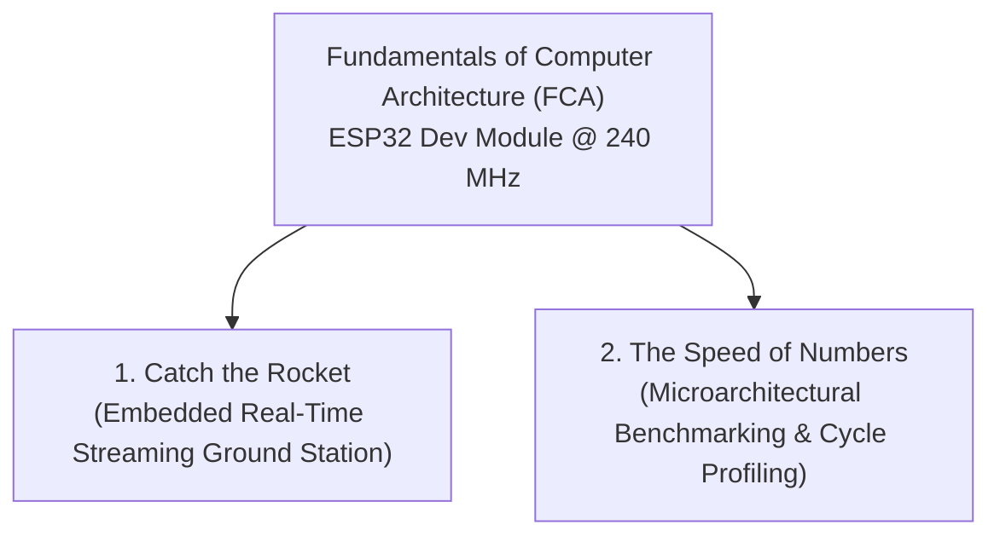

# Fundamentals of Computer Architecture (FCA)

[](https://www.espressif.com/)
[](https://www.arduino.cc/en/software)
[]()
[]()

> **Individual Academic Portfolio**  
> **Course:** Fundamentals of Computer Architecture (FCA)  
> **Author:** Harshitha Paramesh  
> **Target Hardware:** ESP32 Dev Module (Xtensa Dual-Core 32-bit LX6 Microprocessor @ 240 MHz)  

---

## Repository Overview

This repository contains the complete implementation, microarchitectural benchmarks, experimental evidence, and technical reports for the **Fundamentals of Computer Architecture (FCA)** coursework.

The repository is organized into two primary projects:



| Order | Project Name | Directory | Primary Focus | Key Performance Result |
| :---: | :--- | :--- | :--- | :--- |
| **1st** | 🚀 **Catch the Rocket** | [`catch-the-rocket/`](catch-the-rocket/) | Streaming Telemetry & Least-Squares Trajectory Estimation | Worst reading: **10,394 cycles** ($\le 12,000$ budget), State: **248 B** |
| **2nd** | ⏱️ **The Speed of Numbers** | [`speed-of-numbers/`](speed-of-numbers/) | Cycle-Level Arithmetic, FPU Scaling & Real-Time Pipeline Latency | Float FPU (**7.01 cycles**) vs Double (**61.00 cycles**), Q16.16 Fixed Point |

---

## 1. Catch the Rocket (1st Project)

🔗 **Project Folder:** [`catch-the-rocket/`](catch-the-rocket/)

### Executive Summary
**Catch the Rocket** is an embedded real-time ground-station telemetry estimation system implemented on the ESP32. It receives a 100-second flight stream consisting of **100,000 altitude telemetry readings** delivered at 1 kHz (1 reading/ms). 

Because buffering all readings in RAM would exceed microcontroller SRAM capacity, the entire ground station operates as a **single-pass streaming estimator**:
- **Continuous State Memory:** Bounded strictly to **248 bytes** (Limit: $\le 4,096\text{ bytes}$, 94% headroom).
- **Cycle-Accurate Latency:** Measured worst-case reading processing time is **10,394 CPU cycles** (Hardware budget: $\le 12,000\text{ cycles}$, 1,606 cycle safety margin).
- **Online Glitch Rejection:** Formulates a linear extrapolation filter ($\hat{h}_k = 2h_{k-1} - h_{k-2}$, threshold $20.0\text{ m}$) that isolates corrupted readings online without hard-coding timestamps.
- **Flight Parameter Extraction:**
  - Effective Gravity ($g$): $2.0930\text{ m/s}^2$ derived from quadratic least-squares ($t \le 8\text{ s}$).
  - Apogee: Time $2.3730\text{ s}$, Height $1005.9510\text{ m}$.
  - Parachute Deployment: Detected at $t = 8.1980\text{ s}$ via residual departure ($> 15.0\text{ m}$) across 3 consecutive readings.
  - Descent Velocity & Landing: $v_{\text{descent}} = -2.0005\text{ m/s}$, Touchdown predicted at $493.3004\text{ s}$.

### Implementation Progression (`catch-the-rocket/`)
- 📁 [**`codes/level-0/`**](catch-the-rocket/codes/level-0/): Baseline telemetry receiver & 44-byte state structure.
- 📁 [**`codes/level-1/`**](catch-the-rocket/codes/level-1/): Linear least-squares descent regression & touchdown prediction.
- 📁 [**`codes/level-2/`**](catch-the-rocket/codes/level-2/): Quadratic coast ballistics, gravity, and apogee extraction.
- 📁 [**`codes/level-3/`**](catch-the-rocket/codes/level-3/): Parachute deployment detection and arbitrary altitude queries (`ALT t`).
- 📁 [**`codes/level-4/`**](catch-the-rocket/codes/level-4/): Online glitch rejection and adversarial test profile robustness.
- 📁 [**`codes/level-5-final/`**](catch-the-rocket/codes/level-5-final/): Cycle-budget optimization, clean 248-byte state struct, and sub-millisecond command latency (`STATS`, `G`, `APOGEE`, `DEPLOY`, `DESCENT`, `LAND`, `ALT`, `GLITCHES`).
- 📸 [**`preview/`**](catch-the-rocket/preview/): Hardware verification screenshot and verified measurements.

*Read the complete technical specification in [`catch-the-rocket/README.md`](catch-the-rocket/README.md).*

---

## 2. The Speed of Numbers (2nd Project)

🔗 **Project Folder:** [`speed-of-numbers/`](speed-of-numbers/)

### Executive Summary
**The Speed of Numbers** is an empirical computer architecture study investigating instruction execution latency, arithmetic throughput, compiler optimizations, and peripheral bottlenecks on the Xtensa LX6 microprocessor using the scientific **Predict $\rightarrow$ Measure $\rightarrow$ Explain** methodology.

- **Integer Bit-Width Scaling:** Benchmarking 1,000 additions across integer widths reveals that native 32-bit integers (`int32_t`) are the fastest (**8.28 cycles**). 8-bit (`int8_t`, 9.28 cycles) and 16-bit (`int16_t`, 10.18 cycles) types incur penalties due to required sign/zero extension (`sext`) instructions on 32-bit registers.
- **Hardware FPU vs Software Emulation:** The single-precision hardware FPU executes `float` operations in single-digit cycles (Add: **7.01 cycles**, Mult: **8.01 cycles**). Double-precision `double` operations are emulated in software and run **8× to 15× slower** (Add: 61.00 cycles, Mult: 116.90 cycles, Div: 642.82 cycles, Sqrt: 1,094.92 cycles).
- **Bit Manipulation vs Arithmetic:** Bit shifts (`x >> 3`, 6.00 cycles) outperform division (`x / 8`, 8.00 cycles) by **25%**, and bit masking (`x & 15`, 6.00 cycles) outperforms modulo (`x % 16`, 10.00 cycles) by **40%**.
- **Fixed-Point Q16.16:** Employs integer arithmetic to achieve floating-point resolution with integer execution speed and an absolute error of only $6.6 \times 10^{-7}$.
- **Serialization & Print Overhead:** Text formatting (`dtostrf`) costs **6,030 cycles**, while transmitting 1 byte over UART at 115,200 baud consumes **~20,833 cycles** ($86.8\ \mu\text{s}$), demonstrating why serial I/O must never run inside time-critical control loops.
- **Real-Time Sensor Pipeline:** A multi-stage digital filter pipeline benchmarked against strict sampling deadlines: Integer (~220 cycles) and Float (~380 cycles) easily meet 10 kHz, 50 kHz, and 100 kHz deadlines, whereas Double (~3,450 cycles) fails 50 kHz and 100 kHz.

### Code & Experiment Navigator (`speed-of-numbers/`)
- 📁 [**`codes/exp_1/`**](speed-of-numbers/codes/exp_1/): 32-bit addition, 10 vs 1000 repetitions, volatile vs non-volatile benchmarks.
- 📁 [**`codes/exp_2/`**](speed-of-numbers/codes/exp_2/): Integer width comparisons (`int8_t`, `int16_t`, `int32_t`, `int64_t`).
- 📁 [**`codes/exp_3/`**](speed-of-numbers/codes/exp_3/): Single-precision FPU vs double-precision software emulation (Addition, Division, Literal, Multiplication, Sqrt).
- 📁 [**`codes/exp_4/`**](speed-of-numbers/codes/exp_4/): Bit tricks vs arithmetic operators & Xtensa LX6 disassembly analysis.
- 📁 [**`codes/exp_5/`**](speed-of-numbers/codes/exp_5/): Q16.16 fixed-point arithmetic implementation.
- 📁 [**`codes/exp_6/`**](speed-of-numbers/codes/exp_6/): Hidden costs of text formatting (`itoa`, `dtostrf`) & Serial UART transmission.
- 📁 [**`codes/final_challenge/`**](speed-of-numbers/codes/final_challenge/): Real-time multi-stage sensor pipeline implementations.
- 📸 [**`preview/`**](speed-of-numbers/preview/): All raw Serial Monitor logs collected from the ESP32.
- 📁 [**`reports/`**](speed-of-numbers/reports/): Complete academic research Word reports.

*Read the complete experimental results in [`speed-of-numbers/README.md`](speed-of-numbers/README.md).*

---

## Repository Structure

```text
fundamentals-of-computer-architecture/
├── README.md                                          # Master repository portfolio index
├── .gitignore                                         # Build outputs, IDE metadata, and OS ignore patterns
│
├── catch-the-rocket/                                  # 1st: Catch the Rocket Ground Station
│   ├── README.md                                      # Project documentation & mathematical derivation
│   ├── codes/                                         # Level-wise Arduino sketches
│   │   ├── level-0/Level0_to_Level2_Combined/         # Baseline telemetry ingestion
│   │   ├── level-1/Level1_Descent_Landing_HistoricalBase/ # Linear descent & touchdown
│   │   ├── level-2/Level2_Gravity_Apogee_HistoricalBase/  # Quadratic coast, G & apogee
│   │   ├── level-3/Level3_Deployment_ALT_Runnable/    # Deployment detection & ALT query
│   │   ├── level-4/Level4_Glitches_Runnable/          # Online glitch filtering
│   │   └── level-5-final/CatchTheRocket_Level5_Final/ # Final cycle-budget optimized code
│   ├── preview/                                       # Hardware evidence & verified results
│   │   ├── Final_Level5_SerialMonitor.png             # Serial Monitor verification screenshot
│   │   └── verified_results.md                        # Verified physical ESP32 measurements
│   ├── trackers/                                      # Simulated telemetry generator headers
│   ├── docs/                                          # Course reports and source integrity notes
│   └── archive/                                       # Historical and adversarial test sources
│
└── speed-of-numbers/                                  # 2nd: Speed of Numbers Microbenchmarks
    ├── README.md                                      # Project documentation & experimental findings
    ├── Team_Numerix_report.docx                       # Consolidated master research report
    ├── codes/                                         # Experiment-wise Arduino sketches
    │   ├── exp_1/                                     # 32-bit addition & stopwatch calibration
    │   ├── exp_2/                                     # Data type widths (int8, int16, int32, int64)
    │   ├── exp_3/                                     # Float vs Double operations (FPU benchmarking)
    │   ├── exp_4/                                     # Bit tricks vs arithmetic & assembly analysis
    │   ├── exp_5/                                     # Q16.16 fixed-point arithmetic
    │   ├── exp_6/                                     # Text formatting & UART serial overhead
    │   └── final_challenge/                           # Real-time sensor processing pipelines
    ├── preview/                                       # Serial Monitor benchmark captures from ESP32
    │   ├── Experiment_01_Text Document.txt
    │   ├── Experiment_02_Text Document.txt
    │   ├── Experiment_04_Text Document.txt
    │   ├── Experiment_05_Text Document.txt
    │   ├── Experiment_06_Text Document.txt
    │   ├── final_challenge_Text Document.txt
    │   ├── final_challenge_corrected_Text Document.txt
    │   └── exp_3_floating_point/
    ├── reports/                                       # Academic research reports for each experiment
    └── results/                                       # Consolidated benchmark tables
        └── benchmarks_summary.md
```

---

## Hardware and Setup Requirements

- **Microcontroller:** ESP32 Dev Module (Xtensa Dual-Core 32-bit LX6 @ 240 MHz)
- **Development Tool:** Arduino IDE 1.8.x / 2.x
- **Host Connection:** USB-to-UART Bridge @ 115,200 baud (8-N-1)
- **Board Configuration:**
  - Board: `ESP32 Dev Module`
  - CPU Frequency: `240MHz (WiFi/BT)`
  - Flash Frequency: `80MHz`
  - Upload Speed: `921600` (or `115200`)

---

## How to Open and Run

Each sketch in both projects is organized into its own self-contained sketch folder matching the `.ino` filename:
1. Open the `.ino` sketch inside the target project:
   - *Catch the Rocket:* Open `catch-the-rocket/level-5-final/CatchTheRocket_Level5_Final/CatchTheRocket_Level5_Final.ino`.
   - *Speed of Numbers:* Open any experiment, e.g., `speed-of-numbers/exp_3/Experiment_03_Addition/Experiment_03_Addition.ino`.
2. Select your ESP32 board and COM port in the Arduino IDE.
3. Click **Upload** ($\rightarrow$).
4. Open the **Serial Monitor** at **115200 baud** and press the **EN / RST** button on the ESP32.

---

## Individual Attribution

This repository and all included projects represent an **individual academic implementation** designed, programmed, and benchmarked by:

**Harshitha Paramesh**  
Course: *Fundamentals of Computer Architecture (FCA)*  
Platform: ESP32 Dev Board | Arduino IDE
