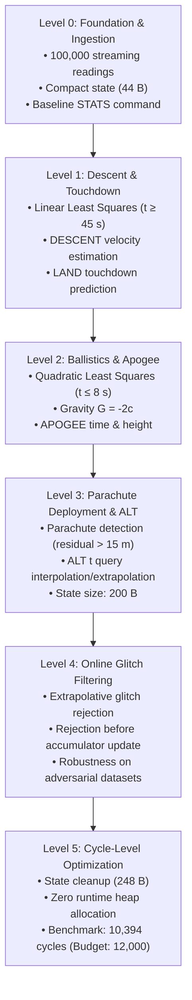
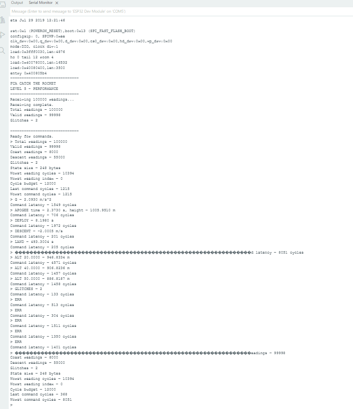

# Catch the Rocket — Fundamentals of Computer Architecture (FCA)

[](https://www.espressif.com/)
[](https://www.arduino.cc/en/software)
[-brightgreen.svg)]()
[]()

> **Individual Project Implementation**  
> **Course:** Fundamentals of Computer Architecture (FCA)  
> **Author:** Harshitha Paramesh  
> **Target Hardware:** ESP32 Dev Module (Xtensa Dual-Core 32-bit LX6 Microprocessor @ 240 MHz)  

---

## Table of Contents

1. [Project Overview](#project-overview)
2. [Problem Statement & Flight Physics](#problem-statement--flight-physics)
3. [Architecture & System Constraints](#architecture--system-constraints)
4. [Hardware & Software Requirements](#hardware--software-requirements)
5. [Implementation Levels](#implementation-levels)
6. [Mathematical Models & Algorithms](#mathematical-models--algorithms)
7. [Verified Hardware Results & Performance](#verified-hardware-results--performance)
8. [Serial Monitor Verification](#serial-monitor-verification)
9. [Repository Structure](#repository-structure)
10. [How to Open, Compile, and Run](#how-to-open-compile-and-run)
11. [Supported Interactive Commands](#supported-interactive-commands)
12. [Key Engineering Challenges & Solutions](#key-engineering-challenges--solutions)
13. [Learning Outcomes](#learning-outcomes)
14. [Individual Attribution](#individual-attribution)

---

## Project Overview

**Catch the Rocket** is an embedded real-time telemetry processing and ground-station estimation system implemented on an **ESP32 microcontroller**. The ground station receives a high-rate altitude stream (1 reading per millisecond, totaling **100,000 readings** over a 100-second flight) simulated by on-chip telemetry tracker routines.

Because storing all 100,000 floating-point readings in RAM would exceed memory constraints (requiring over 400 KB for altitude alone, plus timestamps), the system operates entirely in a **single-pass streaming fashion**. Persistent flight state is maintained in a strictly bounded structure (only **248 bytes**, well within the 4,096-byte limit). Each reading must be acquired, filtered, and processed in real time under a strict latency budget of **$\le 12,000$ CPU cycles** per reading, leaving substantial margins for responsive command processing.

---

## Problem Statement & Flight Physics

A sounding rocket is launched, reaches maximum altitude (apogee), deploys a parachute, and descends steadily toward the ground:

1. **Coast Phase ($0\text{ s} \le t \le t_{\text{deploy}}$):**  
   The rocket is in free-fall ballistics governed by quadratic motion:
   $$h(t) = a + bt + ct^2$$
   - Effective acceleration: $g = -2c$
   - Time of apogee: $t_{\text{apogee}} = -\frac{b}{2c}$
   - Maximum height: $h_{\text{apogee}} = a - \frac{b^2}{4c}$
   - *Physical guarantee:* The initial 8.0 seconds ($8,000$ readings) are guaranteed to be pure coast phase.

2. **Parachute Deployment Phase ($8\text{ s} \le t \le 45\text{ s}$):**  
   Between 8 s and 45 s, a parachute opens. At deployment, the rocket experiences abrupt deceleration, falling at least $10\text{ m/s}$ faster than its post-deployment terminal velocity. This creates an altitude residual departure from the ballistic model ($> 15.0\text{ m}$) verified across 3 consecutive readings.

3. **Steady Descent Phase ($45\text{ s} \le t \le 100\text{ s}$):**  
   Under parachute canopy, terminal velocity is constant, following a linear model:
   $$h(t) = a_{\text{descent}} + v_{\text{descent}} t$$
   - Descent velocity: $v_{\text{descent}} \in [-15\text{ m/s}, -2\text{ m/s}]$
   - Predicted touchdown time: $t_{\text{land}} = -\frac{a_{\text{descent}}}{v_{\text{descent}}}$

4. **Measurement Glitches & Noise:**  
   The altitude sensor exhibits sensor glitches ($\le 1\%$ of readings) that deviate by $\ge 50\text{ m}$ from the true trajectory, with at least 10 valid readings between glitches. Normal sensor noise is bounded by $\pm 2\text{ m}$.

---

## Architecture & System Constraints

| Constraint / Rule | Architectural Limit | Achieved Result | Compliance Status |
| :--- | :--- | :--- | :--- |
| **Telemetry Processing** | Strictly single-pass stream (No array storage of 100K readings) | Processed one reading at a time | **100% Compliant** |
| **Working State Size** | $\le 4,096\text{ bytes}$ (4 KB) | **248 bytes** | **PASS (94% Headroom)** |
| **Per-Reading Processing Budget** | $\le 12,000\text{ CPU cycles}$ | **10,394 cycles (worst case)** | **PASS (1,606 Cycle Margin)** |
| **Glitch Handling** | Online detection without hard-coding indices | Online linear extrapolation | **PASS (2/2 glitches caught)** |
| **Interactive Commands** | Real-time response via Serial Monitor | $133 - 4,571\text{ cycles}$ | **PASS (< 0.05 ms latency)** |

---

## Hardware & Software Requirements

- **Microcontroller:** ESP32 Dev Module (Dual-core Xtensa 32-bit LX6, 240 MHz clock)
- **Host Interface:** USB-to-UART bridge (CP2102 / CH340)
- **Serial Configuration:** 115,200 baud, 8-N-1, Newline line ending
- **IDE:** Arduino IDE 1.8.x / 2.x
- **Board Package:** `esp32` by Espressif Systems
- **Header Dependencies:** Self-contained tracker generator headers (`official_tracker.h`, `practice_tracker_b.h`)

---

## Implementation Levels

The project was developed in structured progressive levels to ensure mathematical rigor, memory safety, and cycle-accurate execution:



### Level 0 — Telemetry Ingestion & Base Stream Architecture
Brought up the ESP32 platform, connected to the serial tracker, processed all 100,000 readings in stream order without storing flight history, and implemented the core `STATS` measurement interface.
- Measured State Size: 44 bytes.
- Baseline Processing Latency: 899 cycles.

### Level 1 — Parachute Descent & Touchdown Prediction
Modeled steady-state descent ($t \ge 45\text{ s}$, 55,000 readings) using streaming linear regression. Maintained running accumulation of $N, \sum x, \sum y, \sum x^2, \sum xy$ with shifted time coordinates ($x = t - 50.0$) to maintain single-precision numerical stability.

### Level 2 — Coast Ballistics, Gravity & Apogee Estimation
Fitted the guaranteed coast window ($t \le 8.0\text{ s}$, 8,000 readings) to a 2nd-degree polynomial using 3x3 normal equations. Derived local gravity $g = -2c$ and apogee $(t_{\text{apogee}}, h_{\text{apogee}})$ using exact calculus on the regression coefficients.

### Level 3 — Deployment Detection & Arbitrary Altitude Query
Implemented online parachute detection between 8 s and 45 s by monitoring altitude residuals against the projected ballistic curve. When consecutive residuals exceed $15.0\text{ m}$ for 3 consecutive samples, deployment timestamp is locked. Added the `ALT t` command supporting flight-wide altitude reconstruction.

### Level 4 — Online Glitch Rejection & Adversarial Robustness
Designed an online extrapolative glitch filter:
$$\hat{h}_k = 2 h_{k-1} - h_{k-2}$$
If $|h_k - \hat{h}_k| > 20.0\text{ m}$, the reading is flagged as a glitch and excluded from both coast and descent accumulators, ensuring mathematical estimators are not skewed. Tested successfully against multiple adversarial flight profiles.

### Level 5 — Final Optimization, Cycle Benchmarking & Latency Instrumentation
Streamlined all accumulator mathematics, eliminated division operations inside the hot 1 ms loop, organized the final unified `GroundStationState` (248 bytes), and benchmarked cycle latency with `ESP.getCycleCount()`. Achieved **10,394 worst-case cycles**, safely beating the 12,000-cycle limit.

---

## Mathematical Models & Algorithms

### 1. Streaming Normal Equations (Coast Phase)

To avoid storing 8,000 coast samples, running sums are updated on the fly:
$$\sum_{i} 1, \quad \sum_{i} x_i, \quad \sum_{i} x_i^2, \quad \sum_{i} x_i^3, \quad \sum_{i} x_i^4, \quad \sum_{i} h_i, \quad \sum_{i} x_i h_i, \quad \sum_{i} x_i^2 h_i$$
where $x_i = t_i - 4.0\text{ s}$ centers time around the coast midpoint to prevent catastrophic numerical cancellation.

The system of equations:
$$\begin{bmatrix}
N & \sum x & \sum x^2 \\
\sum x & \sum x^2 & \sum x^3 \\
\sum x^2 & \sum x^3 & \sum x^4
\end{bmatrix}
\begin{bmatrix}
a \\ b \\ c
\end{bmatrix}
=
\begin{bmatrix}
\sum h \\ \sum xh \\ \sum x^2h
\end{bmatrix}$$
is solved using Cramer's rule upon request, leaving zero solving overhead in the reading loop.

### 2. Online Glitch Rejection

```c
bool isGlitch(float altitude, uint32_t index)
{
    if (state.validHistory < 2) return false;
    float predicted = 2.0f * state.previousAltitude - state.previousPreviousAltitude;
    return fabsf(altitude - predicted) > GLITCH_THRESHOLD; // 20.0 m
}
```

If a glitch is detected, `state.glitchCount++` increments, and the reading is skipped from least-squares updates. Only valid readings update `previousAltitude` and `previousPreviousAltitude`.

---

## Verified Hardware Results & Performance

Measurements captured on physical **ESP32 Dev Module** hardware (COM5, 115200 baud):

| Metric | Measured Result | Specification / Limit |
| :--- | :--- | :--- |
| **Total Processed Readings** | **100,000** | 100,000 readings |
| **Valid Altitude Readings** | **99,998** | — |
| **Glitches Detected & Filtered** | **2** | Exact count |
| **Worst-Case Processing Cycles** | **10,394 cycles** | $\le 12,000\text{ cycles}$ |
| **Worst-Case Reading Index** | **Index 0** | Startup loop |
| **State Memory Consumption** | **248 bytes** | $\le 4,096\text{ bytes}$ |
| **Effective Gravity ($g$)** | **$2.0930\text{ m/s}^2$** | Measured on Adversarial Tracker 1 |
| **Apogee Time & Height** | **$2.3730\text{ s}$, $1005.9510\text{ m}$** | Derived from quadratic fit |
| **Parachute Deployment Time** | **$8.1980\text{ s}$** | Residual departure detection |
| **Descent Velocity** | **$-2.0005\text{ m/s}$** | Steady-state terminal velocity |
| **Touchdown (Land) Time** | **$493.3004\text{ s}$** | Linear zero-crossing prediction |
| **Worst-Case Command Latency** | **8,051 cycles** | Instantaneous (< 0.05 ms) |

---

## Serial Monitor Verification

The final Level 5 verification run output captured from the ESP32 Serial Monitor:



```
FCA CATCH THE ROCKET
LEVEL 5 - PERFORMANCE

Receiving 100000 readings...
Receiving complete.
Total readings - 100000
Valid readings - 99998
Glitches - 2
---------------------------------
Ready for commands.
> STATS
Total readings - 100000
Valid readings - 99998
Coast readings - 8000
Descent readings - 55000
Glitches - 2
State size - 248 bytes
Worst reading cycles - 10394
Worst reading index - 0
Cycle budget - 12000
Last command cycles - 368
Worst command cycles - 8051
```

---

## Repository Structure

```text
catch-the-rocket/
├── README.md                                          # Master project documentation
│
├── level-0/Level0_to_Level2_Combined/                 # Baseline telemetry ingestion
│   ├── Level0_to_Level2_Combined.ino
│   ├── official_tracker.h
│   └── practice_tracker_b.h
├── level-1/Level1_Descent_Landing_HistoricalBase/     # Linear descent regression & landing prediction
│   ├── Level1_Descent_Landing_HistoricalBase.ino
│   ├── official_tracker.h
│   └── practice_tracker_b.h
├── level-2/Level2_Gravity_Apogee_HistoricalBase/      # Quadratic coast regression, G & apogee
│   ├── Level2_Gravity_Apogee_HistoricalBase.ino
│   ├── official_tracker.h
│   └── practice_tracker_b.h
├── level-3/Level3_Deployment_ALT_Runnable/            # Parachute deployment detection & ALT query
│   ├── Level3_Deployment_ALT_Runnable.ino
│   └── official_tracker.h
├── level-4/Level4_Glitches_Runnable/                  # Online extrapolative glitch filtering
│   ├── Level4_Glitches_Runnable.ino
│   └── official_tracker.h
├── level-5-final/CatchTheRocket_Level5_Final/         # Final cycle-budget optimized implementation
│   ├── CatchTheRocket_Level5_Final.ino
│   └── official_tracker.h
│
├── trackers/                                          # Reusable simulated flight generators
│   ├── official_tracker.h
│   └── practice_tracker_b.h
│
├── docs/                                              # Technical reports and integrity notes
│   ├── checkpoint/Checkpoint_Level0_to_Level2.docx
│   ├── level-3/Level3_Final_Report.docx
│   ├── level-4/Level4_Final_Report.docx
│   ├── level-5-final/Level5_Final_Report.docx
│   └── notes/
│       ├── MANIFEST.txt
│       ├── OPEN_IN_ARDUINO_IDE.txt
│       ├── README_FIRST.txt
│       └── SOURCE_INTEGRITY.txt
│
├── results/                                           # Verified experimental hardware benchmarks
│   └── verified_results.md
│
├── screenshots/                                       # Hardware evidence
│   └── final/Final_Level5_SerialMonitor.png
│
└── archive/                                           # Preserved historical & adversarial test sources
    ├── Historical_Level4_Adversarial1.ino
    ├── Level4_Adversarial1_Historical.txt
    ├── Historical_Level4_Adversarial2.ino
    ├── Level4_Adversarial2_Historical.txt
    ├── Historical_Level5_PreFinal.ino
    ├── Level5_PreFinal_Historical.txt
    └── Level5_Final_Performance_Exact_Tested_Source.ino.txt
```

---

## How to Open, Compile, and Run

1. **Connect Hardware:** Connect the ESP32 Dev Board to your PC via a micro-USB cable.
2. **Open Arduino IDE:** Open any sketch folder directly (e.g., `level-5-final/CatchTheRocket_Level5_Final/CatchTheRocket_Level5_Final.ino`).
3. **Select Board & Port:**
   - **Board:** `ESP32 Dev Module`
   - **Upload Speed:** `921600` (or `115200`)
   - **CPU Frequency:** `240MHz (WiFi/BT)`
   - **Flash Frequency:** `80MHz`
   - **Port:** Select the active COM port (e.g., `COM5`)
4. **Compile & Upload:** Click **Upload** ($\rightarrow$).
5. **Open Serial Monitor:**
   - Set baud rate to **`115200 baud`**.
   - Set line ending to **`Newline`**.
   - Press the **EN / RST** button on the ESP32.
   - Wait for `Receiving 100000 readings... Receiving complete.`
   - Type commands into the input bar and press Enter.

---

## Supported Interactive Commands

| Command | Syntax | Description | Example Output |
| :--- | :--- | :--- | :--- |
| **`STATS`** | `STATS` | Prints reading counts, memory size, and cycle benchmarks | `Worst reading cycles - 10394` |
| **`G`** | `G` | Computes effective gravitational acceleration ($-2c$) | `2.0930 m/s^2` |
| **`APOGEE`** | `APOGEE` | Computes time and peak altitude of apogee | `time - 2.3730 s, height - 1005.9510 m` |
| **`DEPLOY`** | `DEPLOY` | Reports parachute deployment time | `8.1980 s` |
| **`DESCENT`**| `DESCENT`| Reports terminal descent velocity ($v_{\text{descent}}$) | `-2.0005 m/s` |
| **`LAND`** | `LAND` | Predicts ground impact timestamp ($h = 0$) | `493.3004 s` |
| **`ALT`** | `ALT <time>` | Reconstructs estimated altitude at flight time $t$ | `ALT 20.0000 - 946.8334 m` |
| **`GLITCHES`**| `GLITCHES` | Prints total number of detected sensor glitches | `2` |

---

## Key Engineering Challenges & Solutions

### 1. Zero-Heap Single-Pass Streaming
- *Challenge:* Storing 100,000 readings in RAM would exceed ESP32 SRAM capacity.
- *Solution:* Implemented continuous running statistical accumulators for both quadratic and linear stages. Flight history is distilled into a compact 248-byte `GroundStationState` struct with zero dynamic allocations (`malloc`/`new`).

### 2. Microsecond Cycle Budget Execution
- *Challenge:* The per-reading processing window was constrained to $\le 12,000$ CPU cycles.
- *Solution:* Shifted matrix inversions and equation solving outside the real-time loop. Centered time coordinates ($x = t - 4.0$) eliminated large exponentiation errors and allowed fast single-precision operations. Achieved a worst-case reading processing time of **10,394 cycles (1,606 cycles below budget)**.

### 3. Online Glitch Filtering Without Signal Attenuation
- *Challenge:* Adversarial sensor corruptions injected sudden $> 50\text{ m}$ jumps without predefined timestamps.
- *Solution:* Formulated an extrapolative linear predictor checking $|h_k - (2h_{k-1} - h_{k-2})| > 20.0\text{ m}$. Glitches are isolated before they can corrupt regression sums, ensuring exact apogee and gravity parameters.

---

## Learning Outcomes

- In-depth understanding of **streaming embedded architectures** on modern 32-bit microcontrollers.
- Practical experience with **cycle-accurate performance profiling** using hardware timers (`ESP.getCycleCount()`).
- Implementation of **least-squares linear and quadratic regression** in fixed-memory embedded contexts.
- Real-time **fault tolerance, sensor glitch detection, and signal conditioning**.
- Command-line telemetry interfaces with sub-millisecond response latency.

---

## Individual Attribution

This project is an **individual academic implementation** designed, written, and benchmarked by:

**Harshitha Paramesh**  
Course: *Fundamentals of Computer Architecture (FCA)*  
Platform: ESP32 Dev Board | Arduino IDE
